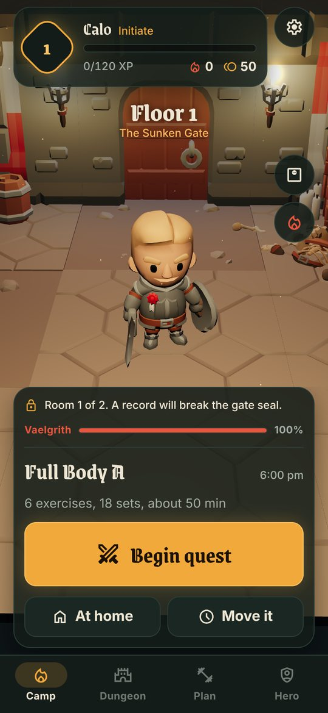
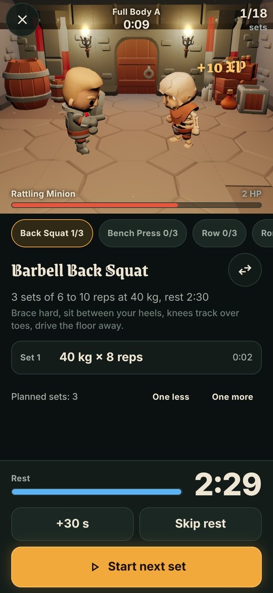
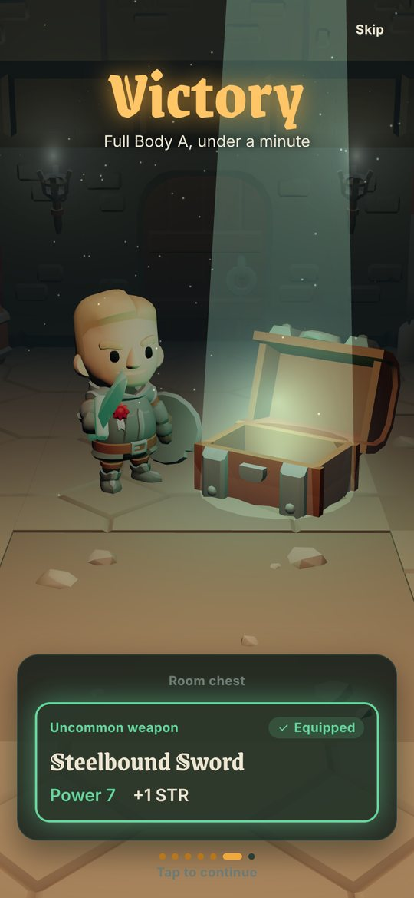
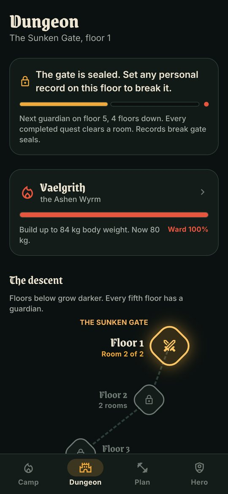
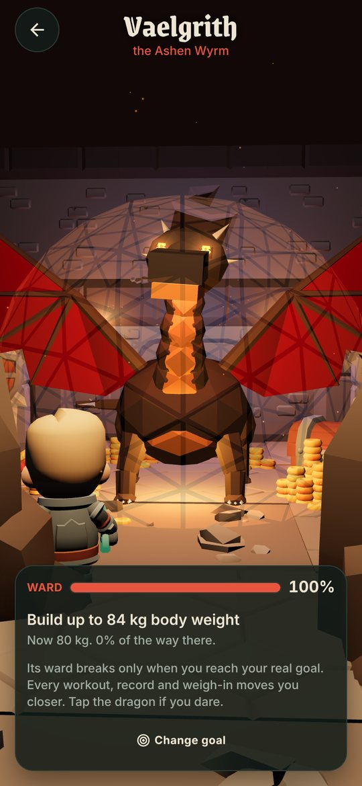

# Ironwyrm

A gym tracker that plays like a 3D dungeon crawler. Every training day you show
up clears a room. Every personal record breaks a gate seal and opens the stairs
down. Minibosses guard every fifth floor with challenges built from your own
numbers. At the bottom waits a dragon whose ward only breaks when you reach your
real goal.

<p>
  
  
  
  
  
</p>

Built with Expo SDK 57, React Native 0.86, Expo Router and React Three Fiber.
It targets Android first (Google Play), and also runs on iOS and the web.

## What it does

**Training**

- Programs generated for your goal (build muscle, fitter and healthier, lose
  fat), experience and number of training days.
- Every exercise set can be edited, reordered or swapped. "I don't have this
  equipment" offers alternatives with the same movement pattern, so push, pull
  and every muscle group stay covered.
- Home and body weight versions of every day.
- Start and end each set to time it. Rest timers with alerts.
- Double progression suggests the next weight; big jumps are flagged.

**Science**

- Weekly volume per muscle against growth windows (MEV to MRV), push and pull
  balance, recovery windows and acute to chronic load spikes.
- A 30 second readiness check-in (sleep, energy, stress, soreness, joint pain)
  trims the plan on rough days instead of skipping them.
- Body weight pace warnings and protein, water and sleep targets scaled to you.
- Sources are listed in the app under Plan, then Science.

**Game**

- +1 Strength for every scheduled training day completed; Endurance, Agility
  and Vitality for rep records, faster sets and body weight milestones.
- XP, levels, gold, five gear slots with rarity loot and pity timers, potions,
  titles, streaks with a shield potion.
- Each set is a strike in a live 3D battle; records land as critical hits.
- A victory sequence after every workout: XP roll-up, level-up pillar, coin
  burst, chest and loot beam, floor descent and dragon damage, with
  synthesized sound and haptics.
- Floors and gates, weekly minibosses and a procedural dragon whose crystal
  ward sheds shards as your real goal gets closer.

**Daily use**

- Reminders at your gym time on training days; move a session earlier or later
  or swap it with a rest day.
- Everything is stored on the device. No account, no ads, no tracking.

## Getting started

New to this? [Install Ironwyrm on your Android phone](docs/install-on-your-phone.md) walks through it step by step.

For development:

```bash
npm install
npx expo start
```

Open it in a development build (`npx expo run:android`, or
`npx eas-cli@latest build --profile development --platform android`), Expo Go,
or press `w` for the browser.

## Scripts

| Command | What it does |
| --- | --- |
| `npm start` | Expo dev server |
| `npm run check` | Typecheck, lint, format check and unit tests |
| `npm test` | Jest unit tests for the domain logic |
| `npm run test:e2e` | Exports the web build and runs the Playwright suite |
| `npm run format` | Prettier |
| `npm run export:web` | Static web build in `dist/` |
| `npm run icons` | Redraws the app icons and store graphics |
| `npm run sounds` | Re-synthesizes the sound effects |

## Project layout

```
src/
  app/          Routes (Expo Router). Thin files that render a screen.
  screens/      One folder per screen.
  components/   Shared UI: buttons, panels, steppers, HUD, goal form.
  domain/       Pure TypeScript: exercises, programs, records, training
                science, schedule, and the game rules in domain/game.
                Fully unit tested, no React.
  state/        Zustand stores (persisted) and every state-changing action.
  game3d/       React Three Fiber: canvas, models, effects, dragon, scenes.
  services/     Sound, haptics and notifications.
  theme/        Design tokens.
assets/         Optimized 3D models, sounds and icons.
scripts/        Asset pipelines (models, sounds, icons).
e2e/            Playwright tests against the web export.
docs/           Store listing, privacy policy and the release guide.
```

## Releasing

See [docs/release-android.md](docs/release-android.md) for EAS builds, Play
Console setup and the release checklist. Store copy is in
[docs/store-listing.md](docs/store-listing.md).

## Credits

- Characters and dungeon pieces: KayKit by Kay Lousberg (CC0).
- Typeface: Grenze Gotisch (SIL Open Font License).
- Sound effects are synthesized by `scripts/build-sounds.py`.

See [assets/CREDITS.md](assets/CREDITS.md).
